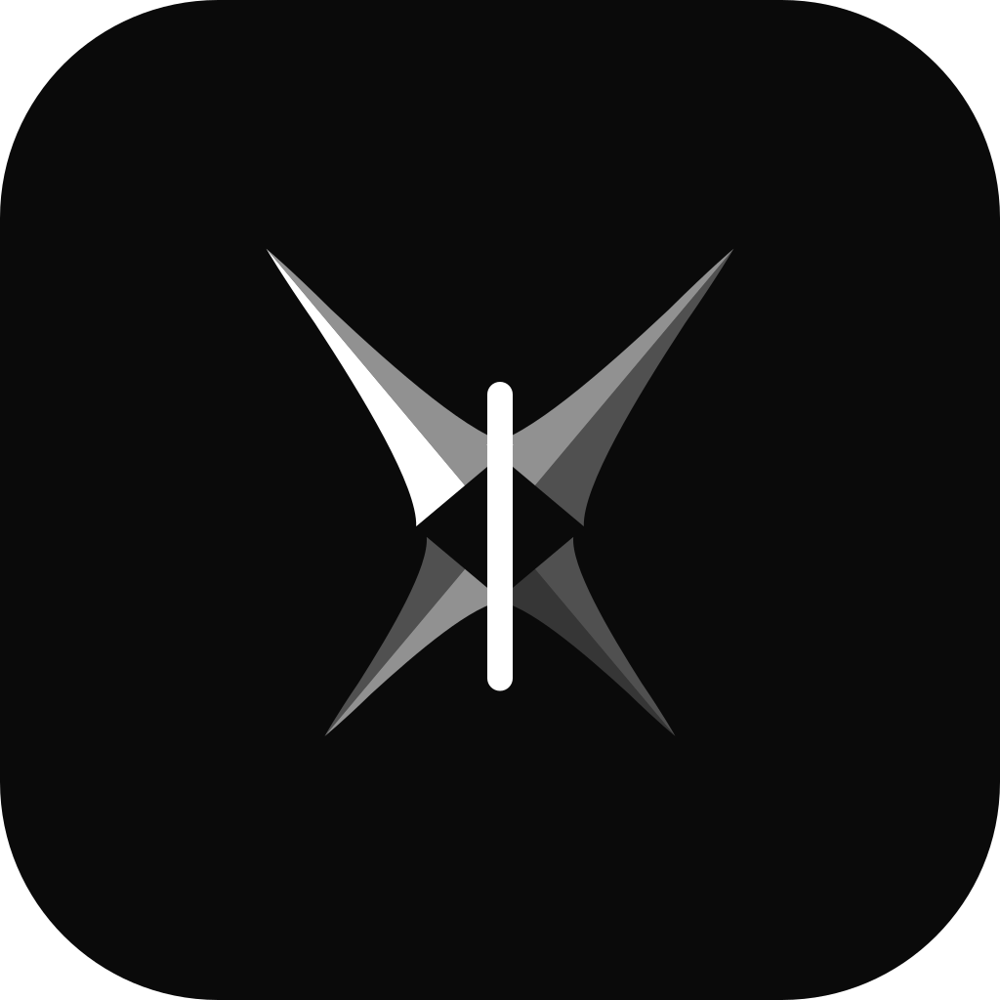

<div align="center">



# Cardea

One command sets up Claude Code on a Mac, wires it to its tools, and runs the services it
talks to on a home NAS.

[](https://github.com/yuzuholic/cardea/actions/workflows/test.yml)
[](https://github.com/yuzuholic/cardea/actions/workflows/docs.yml)
[](LICENSE)
[](https://hub.docker.com/r/yuzuholic/cardea)

**[Read the docs](https://yuzuholic.github.io/cardea/docs)**

<sub>Cardea was the Roman goddess of the door hinge: Forculus had the door, Limentinus the
threshold, Cardea the thing that lets it swing. This repo is the hinge.</sub>

</div>

## Two ways in

Cardea has two entry points, each with its own settings file.

### The Mac: `install.sh`

Installs Claude Code and everything around it: the Homebrew packages, the global rules, four
MCP servers, seven plugins (Cardea's own among them), and the links to the NAS. It asks for the NAS
addresses and Langfuse keys, tests each one as you enter it, and keeps them in `.env`.

Install Xcode 26.3 or later first and keep it running; a script cannot install it.

```sh
git clone https://github.com/yuzuholic/cardea.git ~/Repositories/cardea
cd ~/Repositories/cardea
./install.sh
```

Or, on a fresh machine:

```sh
curl -fsSL https://raw.githubusercontent.com/yuzuholic/cardea/main/install.sh | sh
```

| Flag | Effect |
|---|---|
| *(none)* | Ask for each value, showing the current one. Enter keeps it. |
| `--no-prompt` | Ask nothing and keep whatever `.env` holds. For unattended runs. |
| `--check` | Check the tools and services, then exit. Changes nothing. |

It is safe to run again at any time. Existing config is backed up, never overwritten.

### Windows: `install.ps1`

Links the global rules and the `tldr` and `baby` skills, registers the Hindsight MCP server
and the plugins. Needs Git for Windows, Python 3, uv, pnpm, GitHub CLI, Claude Code and Developer Mode
(Settings > System > For developers) or an elevated shell. Put `NAS_URL` and `HINDSIGHT_MCP_TOKEN` in `.env` to
register Hindsight.

```powershell
powershell -ExecutionPolicy Bypass -File .\install.ps1
pwsh -File .\install.ps1
```

Add `-Check` to report prerequisites and links without changing anything.

### The NAS: `nas/compose.yml`

Runs the self-hosted services (Hindsight and Langfuse) as one service,
`yuzuholic/cardea`, which starts each of them from its official image. Put two things in one
folder on the NAS:

- `compose.yml`, from `nas/`
- `.env`, filled in from `nas/.env.example`

```sh
sudo docker compose up -d
```

[NAS](https://yuzuholic.github.io/cardea/docs/nas) covers the secrets, ports and updates.

## The Claude Code plugin

The skills and agents are a Claude Code plugin. The repo is private, so installing it
outside your checkout needs access to the repo:

```sh
claude plugin marketplace add yuzuholic/cardea
claude plugin install cardea@cardea
```

**21 skills**

| For | Skills |
|---|---|
| The self-hosted stack | `hindsight`, `remember`, `langfuse`, `obsidian`, `graphify` |
| Looking things up | `retrieval-order` |
| Sessions | `handoff`, `herdr` |
| Diagrams | `mermaid` |
| iOS | `rendering-swiftui-previews`, `sim-clone-restore`, `grdb` |
| Reviews and releases | `panel`, `comment-audit`, `pre-commit-audit`, `semantic-commit`, `local-merge`, `post-merge-sweep`, `release-changelog`, `ux-writing` |
| Porting a UI to another framework | `blind-port` |

**7 agents**: the design panel's UX designer, average chud and power user, which the `panel`
skill runs at once and merges into one verdict; and an orchestrator and an implementer for
splitting bigger jobs. The orchestrator plans on Opus and hands each piece to an implementer
on Sonnet, in its own [herdr](https://github.com/ogulcancelik/herdr) pane when there is one.
For a UI that must match a reference, its `blind-port` skill also starts a describer, who
sees the reference and briefs the implementer in words, and a reviewer, who audits the code.

**6 hooks**: a note at the start of each session on where to look things up, a block on
reading private keys, a blind mode that hides a reference frontend
from the blind implementer, a check that commit messages are `<type>: <subject>`, a one-time
reminder to check notes and code before the web, and a one-time nudge to hand off before
autocompact.

Skills load when a task calls for them, not in every session. `install.sh` installs the
plugin from your checkout. Claude Code keeps its own copy, so after editing a skill or hook
here, refresh it and start a new session: rerun `./install.sh`, which updates every plugin,
or for a quick refresh run `claude plugin update cardea@cardea`.

## What's in the stack

| Area | Tool |
|---|---|
| Agent | [Claude Code](https://github.com/anthropics/claude-code) |
| Tracing | [Langfuse](https://github.com/langfuse/langfuse), self-hosted |
| Memory | Hindsight, self-hosted |
| Code understanding | [graphify](https://pypi.org/project/graphifyy/) |
| iOS | [XcodeBuildMCP](https://github.com/cameroncooke/XcodeBuildMCP), [SwiftLens](https://github.com/swiftlens/swiftlens), Xcode's `mcpbridge`, [xcode-build-server](https://github.com/SoundBlaster/xcode-build-server) |
| Terminal | [herdr](https://github.com/ogulcancelik/herdr), [gum](https://github.com/charmbracelet/gum) for the installer |

Every version is pinned where it can be. [Stack](https://yuzuholic.github.io/cardea/docs/stack)
lists each pin, and [Decisions](https://yuzuholic.github.io/cardea/docs/decisions) says why
the stack looks like this.

## Repo layout

| Path | What it is |
|---|---|
| `install.sh` | The Mac install. |
| `Brewfile` | Homebrew packages. |
| `claude/CLAUDE.md` | Global rules, linked to `~/.claude/CLAUDE.md`. |
| `claude/skills/tldr/` | The tldr skill, linked to `~/.claude/skills/tldr`. |
| `claude/skills/baby/` | The baby skill, linked to `~/.claude/skills/baby`. |
| `.claude-plugin/` | The marketplace manifest, so `claude plugin marketplace add` finds the plugin. |
| `plugins/cardea/` | The plugin: skills and agents. |
| `nas/` | The NAS side: `compose.yml`, `.env.example`, and the launcher image with the stack it runs. |
| `scripts/vendor-skills.sh` | Generates herdr's and graphify's own skills from the installed tools, and copies marimo's notebook skill. |
| `tests/` | The tests below. |
| `docs/` | The docs site (Fumadocs on GitHub Pages). |

## Tests

Each test is one script: `sh tests/<name>.sh`. CI runs them all, plus a docs build.

| Test | What it guards | Needs |
|---|---|---|
| `plugin` | The marketplace and plugin validate, and every skill and agent has a name and description. | Claude Code |
| `hooks` | Secrets and badly formed commit messages are blocked, everything else passes, and the session note copes with the NAS being down. | python3, git |
| `vendor-skills` | All three vendored skills are produced, a rerun replaces them cleanly, and your `CLAUDE.md` is never touched. | herdr, graphify, network |
| `nas` | The launcher builds, missing secrets are named, the stack renders with the right paths, and it really starts, picks up `.env` changes and stops. | Docker |
| `install` | `install.sh` end to end against stand-in tools and a stand-in NAS: every prompt case, `--no-prompt`, `--check`, and piping from curl, with and without gum. | expect, python3 |

To read the docs locally: `cd docs && pnpm install && pnpm dev`.

## License

[MIT](LICENSE) © yuzuholic
