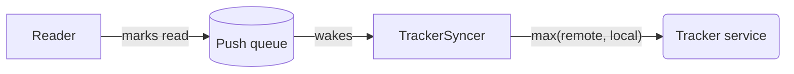

# Note templates

Copy the block for the note's `type`, then replace every `<placeholder>`. The page anatomy and
writing rules are in [SKILL.md](SKILL.md).

## Decision

Modelled on MADR.

````markdown
---
type: decision
status: accepted
tags: [<area>]
aliases: []
updated: YYYY-MM-DD
---
# <Use X for Y>

Part of [[<Area>]]

<One to three sentences: what was decided and why it matters.>

## Context

<The problem and the forces that shaped the choice.>

## Decision

<What was chosen, stated plainly, with how it works where that is not obvious.>

## Options considered

| Option | Good | Not good |
|---|---|---|
| <Chosen option> | <...> | <...> |
| <Rejected option> | <...> | <...> |

## Consequences

- <What this makes easier.>
- <What it costs or rules out.>

---
# Basic Memory

## Key facts
- [decision] <the choice in one line>
- [rejected] <option>: <reason>

## Relations
- part_of [[<Area>]]
````

## Reference

````markdown
---
type: reference
tags: [<area>]
aliases: []
updated: YYYY-MM-DD
---
# <Subject>

Part of [[<Area>]]

<One to three sentences: what this covers and when you need it.>

```toc
```

## <First group>

<Short description, then bullets or a table. One fact per bullet, each with its reason.>

## <Second group>

<...>

## Example

```swift
<a short, real example>
```

---
# Basic Memory

## Key facts
- [rule] <...>
- [fact] <...>

## Relations
- part_of [[<Area>]]
````

## Gotcha

````markdown
---
type: gotcha
tags: [<area>]
aliases: []
updated: YYYY-MM-DD
---
# <What goes wrong, as the symptom>

Part of [[<Area>]]

<One to two sentences: the symptom and where it bites.>

## Symptom

<What you see.>

## Cause

<Why it happens.>

## Fix

<What to do instead, with a short code example where it helps.>

> [!warning]
> <The one line a reader must remember.>

---
# Basic Memory

## Key facts
- [gotcha] <symptom and cause in one line>
- [rule] <the fix in one line>

## Relations
- part_of [[<Area>]]
````

## Constraint

````markdown
---
type: constraint
tags: [<area>]
aliases: []
updated: YYYY-MM-DD
---
# <The rule, stated as a rule>

Part of [[<Area>]]

<One sentence: the rule.>

## Why

<What breaks, or what it protects, if the rule is ignored.>

## Applies to

<The code, screens or data it covers, and any exceptions.>

---
# Basic Memory

## Key facts
- [constraint] <the rule in one line>

## Relations
- part_of [[<Area>]]
````

## Plan

````markdown
---
type: plan
tags: [<plan>]
aliases: []
updated: YYYY-MM-DD
---
# <What the work delivers>

Part of [[<Plan area or Plans>]]

<One to three sentences: the goal and its current state.>

```toc
```

## Goal

<What done looks like.>

## Approach

<How it will be built, in stages if it has them.>

## Status

| Stage | State | Notes |
|---|---|---|
| <Stage> | done, in progress or not started | <...> |

## Open questions

- <Question, and who answers it.>

---
# Basic Memory

## Key facts
- [decision] <...>
- [todo] <...>

## Relations
- part_of [[<Plan area or Plans>]]
````

## Area

A portal page named after the area, linking every page in it.

````markdown
---
type: area
tags: [<area>]
aliases: [<Area> overview]
updated: YYYY-MM-DD
---
# <Area name>

Part of [[<Project front page>]]

<Two to four sentences: what this part of the project does and how its pages are grouped.>

```toc
```

## <Group of pages>

- [[<Page title>]]: <one line on what it covers>
- [[<Page title>]]: <...>

## Related areas

- [[<Area>]]: <how it connects>

---
# Basic Memory

## Key facts
- [fact] <what this area owns, in one line>

## Relations
- part_of [[<Project front page>]]
````

## Diagrams

Mermaid renders natively in Obsidian. Add a diagram when a page describes a flow, a sequence of
calls, a state machine, a schema or an architecture, and the picture is clearer than the prose
alone. It supports the text and never replaces it. Diagrams belong mostly in reference, plan
and area pages.

| Rule | Detail |
|---|---|
| Type by content | `flowchart` for a process or decision path, `sequenceDiagram` for interactions over time, `stateDiagram-v2` for state machines, `erDiagram` for tables and keys, `flowchart LR` with `subgraph`s for architecture at the C4 container level |
| Direction | `LR` for pipelines and architecture, `TD` for hierarchies and decision trees |
| Size | At most about 12 nodes. Split a larger picture into an overview and a drill-down |
| Labels | Sentence case, one to four words, real names. Code names in quotes. Label every edge that is not obvious with a verb: `-->|pushes|` |
| Shapes | `[ ]` component, `[( )]` storage, `( )` start or end, `{ }` decision |
| Styling | None: no colours, `classDef` or `style`. The theme handles dark and light mode, and colour never carries meaning |
| Placement | Inside the section it explains, after a sentence saying what it shows |
| Links | Basic Memory does not index links inside a diagram, and they do not reach the graph, so every page a diagram names is also linked in the prose |


