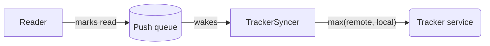

# Mermaid

A diagram supports the text and never replaces it. Draw one when a flow, a sequence of calls,
a state machine, a schema or an architecture is clearer as a picture than as prose alone.

## Rules

| Rule | Detail |
|---|---|
| Type by content | `flowchart` for a process or decision path, `sequenceDiagram` for interactions over time, `stateDiagram-v2` for state machines, `erDiagram` for tables and keys, `flowchart LR` with `subgraph`s for architecture at the C4 container level |
| Direction | `LR` for pipelines and architecture, `TD` for hierarchies and decision trees |
| Size | At most about 12 nodes. Split a larger picture into an overview and a drill-down |
| Labels | Sentence case, one to four words, real names. Code names go in quotes. Label every edge that is not obvious with a verb: `-->|pushes|` |
| Shapes | `[ ]` component, `[( )]` storage, `( )` start or end, `{ }` decision |
| Styling | None. No colours, `classDef` or `style`; the theme handles dark and light mode, and colour never carries meaning |
| Placement | Inside the section it explains, after a sentence that says what it shows |



Notes in Basic Memory add one rule of their own: see the Diagrams section of the
`basic-memory` skill's templates.

## Showing a diagram

When the user should see a diagram rendered, open it in mermaid.live rather than copying it to
the clipboard. The script packs the diagram into the link itself, so nothing is uploaded and
the editor opens with the diagram ready to view, edit or export.

```sh
python3 -I scripts/open.py diagram.mmd
python3 -I scripts/open.py < diagram.mmd
python3 -I scripts/open.py diagram.mmd --no-open
```

Paths are relative to this skill's folder. The input is bare Mermaid or a single fenced
` ```mermaid ` block. The script prints the link and opens it in the default browser;
`--no-open` only prints it, for a headless session or to paste the link into a note or chat.
It checks that the link decodes back to the diagram before printing it.

Write the diagram to a file in the scratchpad first, so it can be fixed and reopened. If the
editor shows a syntax error, fix the file and run the script again.
